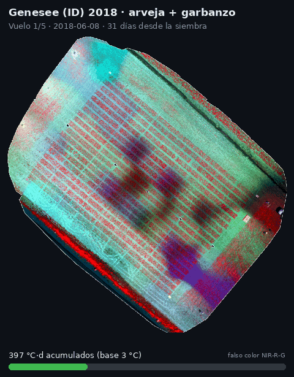
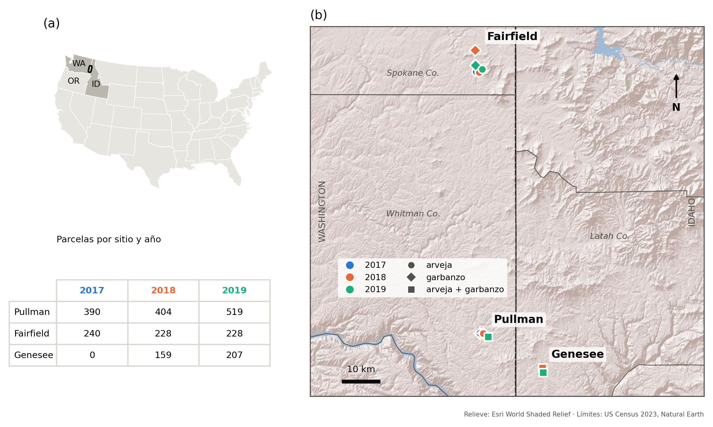
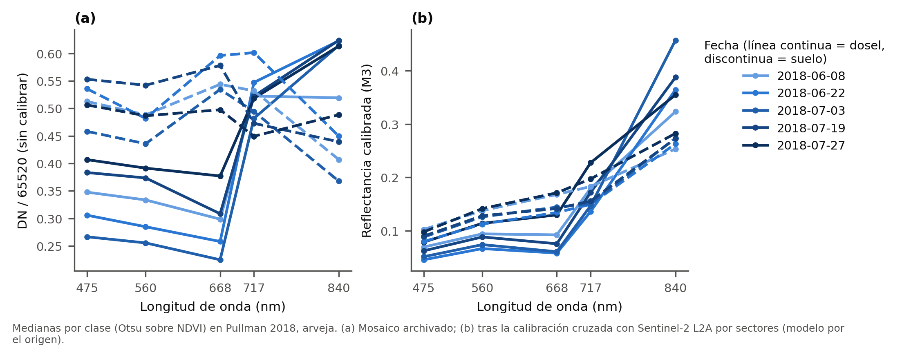
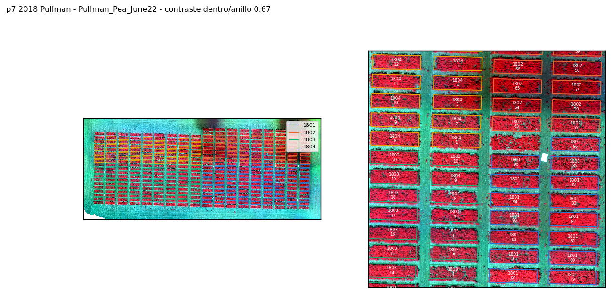
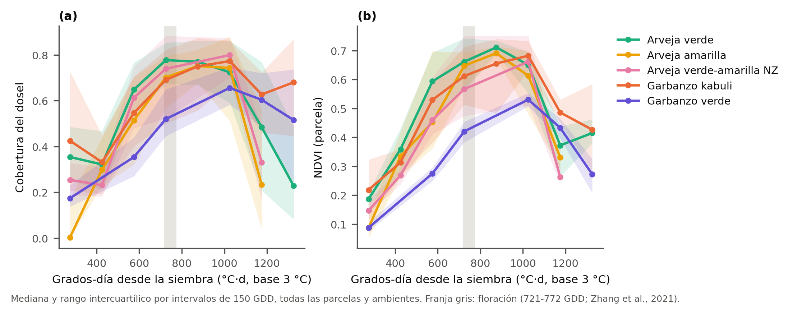
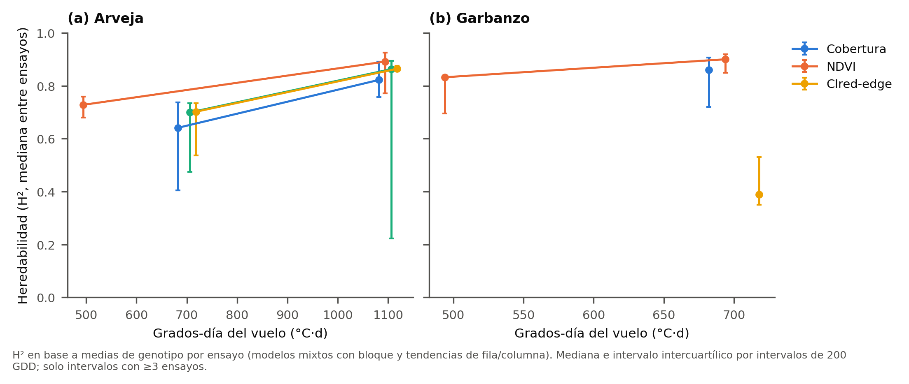
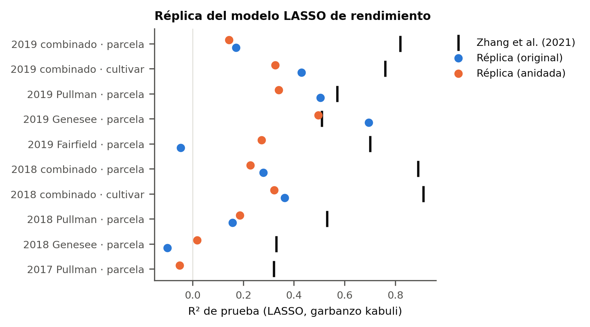
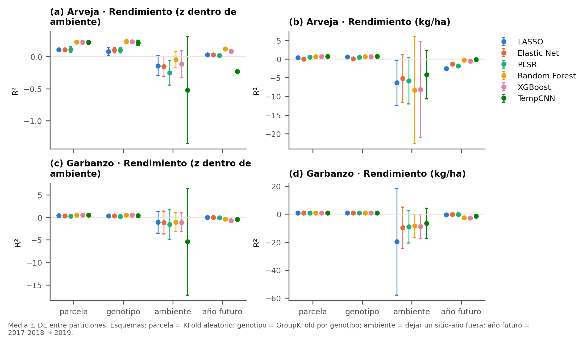
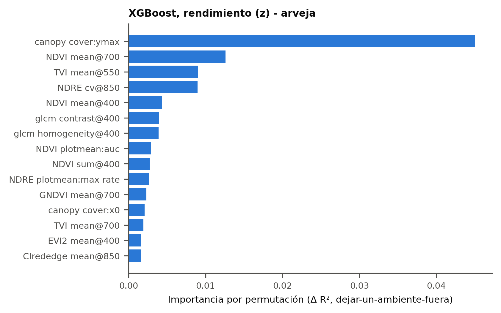

<p align="center">
  
</p>

<p align="center">
  
  
  
  
  
  
</p>

<p align="center">
  <b>Jesús Enrique Flores Riera</b> · Maestría en Geomática · Universidad Nacional de Colombia
</p>

---

## De qué trata

Este repositorio reprocesa desde cero, con código abierto, **tres temporadas (2017–2019) de imágenes multiespectrales
tomadas con dron** sobre ensayos de mejoramiento de **arveja** (*Pisum sativum*) y **garbanzo** (*Cicer arietinum*) del
USDA-ARS y Washington State University, en Pullman (WA), Fairfield (WA) y Genesee (ID).

El trabajo replica el estudio de **Zhang et al. (2021)** y lo amplía en cuatro direcciones:

| Pregunta | Cómo se responde |
|---|---|
| ¿Se pueden comparar imágenes de distintas fechas y años si no son reflectancia? | Calibración cruzada con **Sentinel-2 L2A** por sectores |
| ¿Cómo crece y envejece el dosel de cada genotipo? | Curvas en **grados-día** (tiempo térmico) |
| ¿Los rasgos medidos con dron son heredables y útiles para seleccionar? | **Modelos mixtos**: H², correlación genética, G×E |
| ¿Los modelos predicen genotipos y ambientes **nuevos**? | **Aprendizaje automático** con 4 esquemas de validación |

<p align="center">
  <br>
  <sub>Cinco vuelos sobre el mismo lote (Genesee 2018, falso color NIR-R-G). El dosel crece hasta cerrar las calles y luego
  la arveja envejece (tonos claros) mientras el garbanzo sigue verde (rojo intenso).</sub>
</p>

## El trabajo en cifras

<table align="center">
  <tr>
    <td align="center"><h3>55</h3>vuelos inventariados<br><sub>46 utilizables</sub></td>
    <td align="center"><h3>2415</h3>parcelas en 34 ensayos<br><sub>303 genotipos</sub></td>
    <td align="center"><h3>8079</h3>registros<br>parcela × vuelo</td>
    <td align="center"><h3>442</h3>sectores de 20 m<br>para calibrar</td>
    <td align="center"><h3>6</h3>modelos de ML<br>× 4 validaciones</td>
  </tr>
</table>

## Flujo de trabajo

<p align="center">
  
</p>

Cada paso es un programa numerado en [`pipeline/`](pipeline/) y guarda sus resultados en `outputs/NN_*/`. El diagrama se
genera con [`docs/img/workflow_svg.py`](docs/img/workflow_svg.py).

## Las partes del trabajo

<details open>
<summary><b>① Inventario y control de calidad</b> · pasos <code>01</code>–<code>04</code></summary>

<br>

| Paso | Qué hace | Resultado clave |
|---|---|---|
| [`01_inventory_images.py`](pipeline/01_inventory_images.py) | Inventaría los 275 ortomosaicos (5 bandas × 55 vuelos): tamaño, resolución, sistema de referencia y bandas faltantes | 34 archivos vacíos; 44 vuelos con las 5 bandas completas |
| [`02_qc_tabular.py`](pipeline/02_qc_tabular.py) | Consolida las hojas de campo y revisa conteos, duplicados, unidades, fechas y repetibilidad del rendimiento | 2415 parcelas en 34 ensayos; 8 problemas documentados (p. ej., rendimiento rotulado en g/ha cuando es kg/ha) |
| [`03_spectral_histograms.py`](pipeline/03_spectral_histograms.py) | Histogramas, firmas espectrales y vistas rápidas en falso color por vuelo | Los mosaicos están en números digitales, **no en reflectancia** |
| [`04_context_maps.py`](pipeline/04_context_maps.py) | Mapa de localización, ensayos por lote y calendario de vuelos | En Fairfield el garbanzo está en lotes a 2–6 km de la arveja |

Todas las decisiones sobre los datos están en [`docs/DATA_ISSUES.md`](docs/DATA_ISSUES.md).

<p align="center"></p>
</details>

<details>
<summary><b>② Preprocesamiento geomático</b> · pasos <code>05</code>–<code>07b</code>, <code>09</code></summary>

<br>

| Paso | Qué hace | Resultado clave |
|---|---|---|
| [`05_radiometric_calibration.py`](pipeline/05_radiometric_calibration.py) | Calibra cada vuelo contra la escena Sentinel-2 L2A más cercana (≤ 6 días): agrega a 2 m, simula la PSF del satélite, busca el desfase y ajusta en sectores homogéneos de 20 m | R² agrupado de 0,59–0,95; modelo elegido por **plausibilidad física**, no por R² |
| [`06_parse_plot_maps.py`](pipeline/06_parse_plot_maps.py) | Lee los croquis en PDF por el color vectorial de las celdas y reconstruye filas, columnas y ensayos | 34/34 ensayos coinciden 1:1 con los datos de campo |
| [`07_georef_plot_grid.py`](pipeline/07_georef_plot_grid.py) | Registra la captura del croquis sobre el mosaico (rotación, escala y aspecto) y lleva cada parcela a coordenadas UTM | Grillas en los 12 lotes |
| [`07b_check_plot_grid.py`](pipeline/07b_check_plot_grid.py) | Refinamiento afín que maximiza el contraste de vegetación dentro y fuera de cada parcela | Espaciamiento físico correcto (6,1 × 2,0 m); contraste mediano 0,50 |
| [`09_coregistration.py`](pipeline/09_coregistration.py) | Ajusta la grilla a cada vuelo, porque los mosaicos de distintas fechas están desplazados entre sí | Desplazamiento mediano 0,68 m (máx. 2,1 m); contraste 0,08 → 0,40 |

Los métodos de calibración comparados están en [`docs/RADIOMETRIC_METHODS.md`](docs/RADIOMETRIC_METHODS.md).

<p align="center">
  
  
</p>
</details>

<details>
<summary><b>③ Rasgos por parcela y fecha</b> · pasos <code>08</code>, <code>10</code></summary>

<br>

| Paso | Qué hace | Resultado clave |
|---|---|---|
| [`08_weather_gdd.py`](pipeline/08_weather_gdd.py) | Descarga el clima diario de Daymet V4 por lote y calcula grados-día desde la siembra (base 3 °C) | Cada vuelo queda ubicado en tiempo térmico |
| [`10_features.py`](pipeline/10_features.py) | Enmascara suelo y flores (Otsu sobre SAVI) y resume por parcela: cobertura, 11 índices (NDVI, GNDVI, SAVI, NDRE, TVI, OSAVI, EVI2, MCARI, CIgreen, CIred-edge, MTCI), percentiles y textura GLCM | 8079 registros parcela × vuelo de 2172 parcelas y 46 vuelos |
</details>

<details>
<summary><b>④ Réplica y análisis biológico</b> · pasos <code>11</code>–<code>14</code></summary>

<br>

| Paso | Qué hace | Resultado clave |
|---|---|---|
| [`11_replication.py`](pipeline/11_replication.py) | Correlaciones y LASSO con la configuración de Zhang et al. (2021), más una variante **sin fuga de información** | Las correlaciones se replican (\|r\| hasta 0,88) |
| [`11b_replication_sensitivity.py`](pipeline/11b_replication_sensitivity.py) | Compara estandarizar dentro de cada sitio o sobre todos los sitios juntos | El R² alto publicado (0,82–0,89) solo aparece al estandarizar sobre todos los sitios; dentro de sitio baja a 0,14–0,28 |
| [`12_temporal.py`](pipeline/12_temporal.py) | Curvas logísticas por parcela: máximo, tasa, inflexión, área bajo la curva y senescencia | Inflexión de la cobertura a 446–530 °C·d, antes de la floración |
| [`13_mixed_models.py`](pipeline/13_mixed_models.py) | Modelos mixtos: heredabilidad, correlación con el rendimiento a nivel genotípico, coincidencia de selección y G×E | H² de 0,72–0,83; correlación con rendimiento 0,66–0,69 en garbanzo y ≤ 0,18 en arveja |
| [`14_phenology.py`](pipeline/14_phenology.py) | Predice días a floración y a madurez desde las series temporales | Error de 3–5,5 días; útil para ordenar dentro de un ensayo |

<p align="center">
  
  
</p>
<p align="center"></p>
</details>

<details>
<summary><b>⑤ Aprendizaje automático, figuras y tablas</b> · pasos <code>15</code>–<code>16</code></summary>

<br>

| Paso | Qué hace | Resultado clave |
|---|---|---|
| [`15_models.py`](pipeline/15_models.py) | LASSO, red elástica, PLSR, bosque aleatorio, XGBoost y TempCNN, validados por parcela, genotipo excluido, ambiente excluido y año futuro; SHAP e importancia por permutación | ρ de Spearman ≈ 0,71 (garbanzo) y 0,46 (arveja) con genotipos nuevos; los árboles igualan a la red neuronal con ~10 veces menos tiempo |
| [`15b_absolute_features.py`](pipeline/15b_absolute_features.py) | Compara reflectancia calibrada absoluta con rasgos estandarizados para predecir en ambientes nuevos | En garbanzo, el error baja de 820 a 548–590 kg/ha |
| [`16_figures_tables.py`](pipeline/16_figures_tables.py) | Genera las figuras y tablas finales con un estilo común | 22 figuras y 5 tablas en [`outputs/16_figures/`](outputs/16_figures/) |

El plan de modelado está en [`docs/MODELING_PLAN.md`](docs/MODELING_PLAN.md).

<p align="center">
  
  
</p>
</details>

## Hallazgos principales

> [!NOTE]
> 1. **Los mosaicos archivados no eran reflectancia**, pero pudieron armonizarse con Sentinel-2 y código abierto.
> 2. **Las correlaciones publicadas se replican**; las exactitudes altas de los modelos combinados reflejan sobre todo
>    diferencias entre ambientes, no entre genotipos.
> 3. **Los rasgos del dron son heredables** en ambos cultivos, pero se asocian con el rendimiento sobre todo en garbanzo.
> 4. **La calibración radiométrica permite transferir** las predicciones de garbanzo a ambientes nuevos.

## Estructura del repositorio

```text
pea_drone/
├── pipeline/              programas numerados (01 → 16), uno por paso
│   ├── config.py          rutas, bandas y lectura de nombres de archivo
│   ├── common.py, style.py    funciones y estilo gráfico compartidos
│   └── run_pipeline.py    orquestador: ejecuta los pasos en orden, con log y tiempo estimado
├── outputs/               resultados de cada paso (tablas, figuras, reportes)
│   └── 16_figures/        figuras y tablas finales + RESULTS_SUMMARY.md
├── docs/
│   ├── WORKFLOW.md            metodología completa (fases 0-7)
│   ├── ROADMAP.md             hecho / pendiente
│   ├── DEVELOPMENT_LOG.md     bitácora: qué se ejecutó, qué falló y cómo se corrigió
│   ├── DATA_ISSUES.md         problemas de los datos y decisiones tomadas
│   ├── RADIOMETRIC_METHODS.md métodos de calibración comparados
│   ├── MODELING_PLAN.md       plan de los modelos de ML/DL
│   ├── logs/                  logs originales completos de cada paso
│   └── img/                   imágenes de este README
├── CITATION.cff
└── requirements.txt
```

## Cómo reproducirlo

```bash
pip install -r requirements.txt
python pipeline/01_inventory_images.py
python pipeline/02_qc_tabular.py
python pipeline/03_spectral_histograms.py
python pipeline/04_context_maps.py              # requiere data_ext/ (Natural Earth + US Census)
python pipeline/05_radiometric_calibration.py   # luego 06 y 07 (ver docs/WORKFLOW.md)
python pipeline/run_pipeline.py --from 07b      # resto en secuencia (07b → 16) con log y tiempo estimado
```

Los datos crudos (ortomosaicos `Images20NN/`, `20NNPulseDataset.xlsx`, `PulsePlotMaps_2017-2019.pdf`) **no se
versionan**: pertenecen a WSU/USDA-ARS. Se colocan en la raíz del repositorio con la misma estructura de carpetas.

## Fuentes de datos

| Datos | Proveedor / repositorio | Acceso |
|---|---|---|
| Ortomosaicos UAV, datos de campo y croquis (2017–2019) | USDA-ARS y Washington State University ([Zhang et al., 2021](https://doi.org/10.3389/fpls.2021.640259)) | Facilitados por los autores, no públicos |
| Sentinel-2 MSI Nivel 2A | Copernicus/ESA, vía [Microsoft Planetary Computer](https://planetarycomputer.microsoft.com/dataset/sentinel-2-l2a) | API STAC abierta |
| Daymet V4 R1 (clima diario, 1 km) | ORNL DAAC ([doi:10.3334/ORNLDAAC/2129](https://doi.org/10.3334/ORNLDAAC/2129)) | API abierta de un píxel |
| Límites administrativos | [Natural Earth](https://www.naturalearthdata.com) y [U.S. Census Bureau](https://www.census.gov/geographies/mapping-files/time-series/geo/cartographic-boundary.html) | Descarga abierta |
| Mapas base | Esri World Shaded Relief y World Imagery | Servicios de teselas |

## Autor

**Jesús Enrique Flores Riera** — candidato a Maestría en Geomática, Universidad Nacional de Colombia
([jfloresr@unal.edu.co](mailto:jfloresr@unal.edu.co)).

Autor único del diseño metodológico, el análisis, el código y la documentación de este repositorio.

## Nota sobre el uso de inteligencia artificial

En este proyecto se usaron herramientas de inteligencia artificial generativa como apoyo para **documentar el código**
(comentarios, descripciones de los programas y bitácora) y para **organizar el repositorio** (estructura de carpetas y
este README). El diseño del estudio, las decisiones metodológicas, la ejecución de los análisis, la verificación de los
resultados y su interpretación son del autor, que revisó todo el contenido y es responsable de él. Las herramientas de
IA no figuran como autoras.

## Cómo citar

Use el botón **"Cite this repository"** de GitHub (archivo [`CITATION.cff`](CITATION.cff)) o:

> Flores Riera, J. E. (2026). *pea_drone: flujo reproducible para el fenotipado UAV multiespectral de arveja y garbanzo
> (2017–2019)* [Programa informático]. GitHub. https://github.com/jf-floresriera/pea_drone

## Créditos de los datos

Los ensayos y las imágenes no son del autor: pertenecen a R. J. McGee y G. J. Vandemark (USDA-ARS Grain Legume Genetics
and Physiology Research Unit) y a S. Sankaran y C. Zhang (WSU Biological Systems Engineering). Se usan con autorización,
citando el estudio original:

> Zhang, C., McGee, R. J., Vandemark, G. J., & Sankaran, S. (2021). Crop performance evaluation of chickpea and dry pea
> breeding lines across seasons and locations using phenomics data. *Frontiers in Plant Science*, 12, 640259.
> https://doi.org/10.3389/fpls.2021.640259
